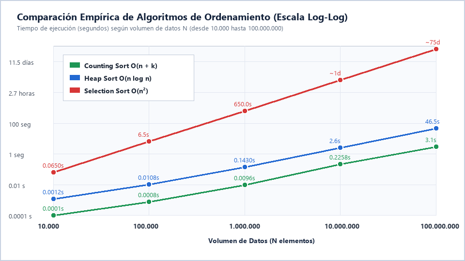
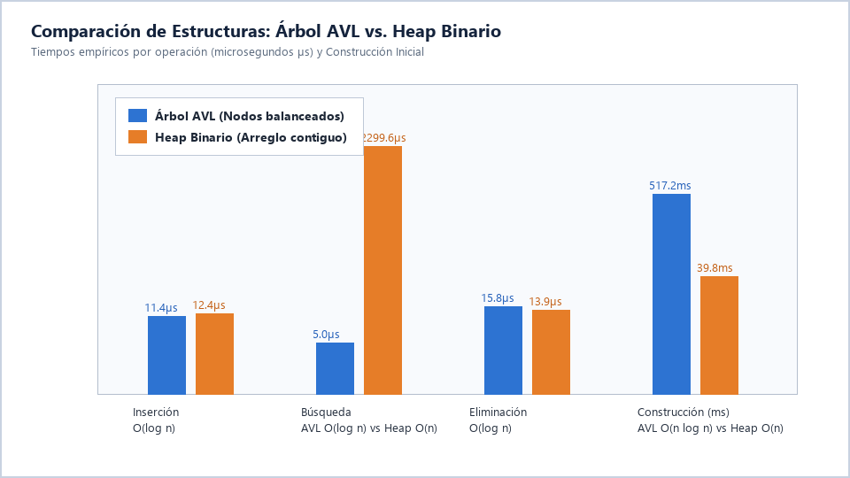
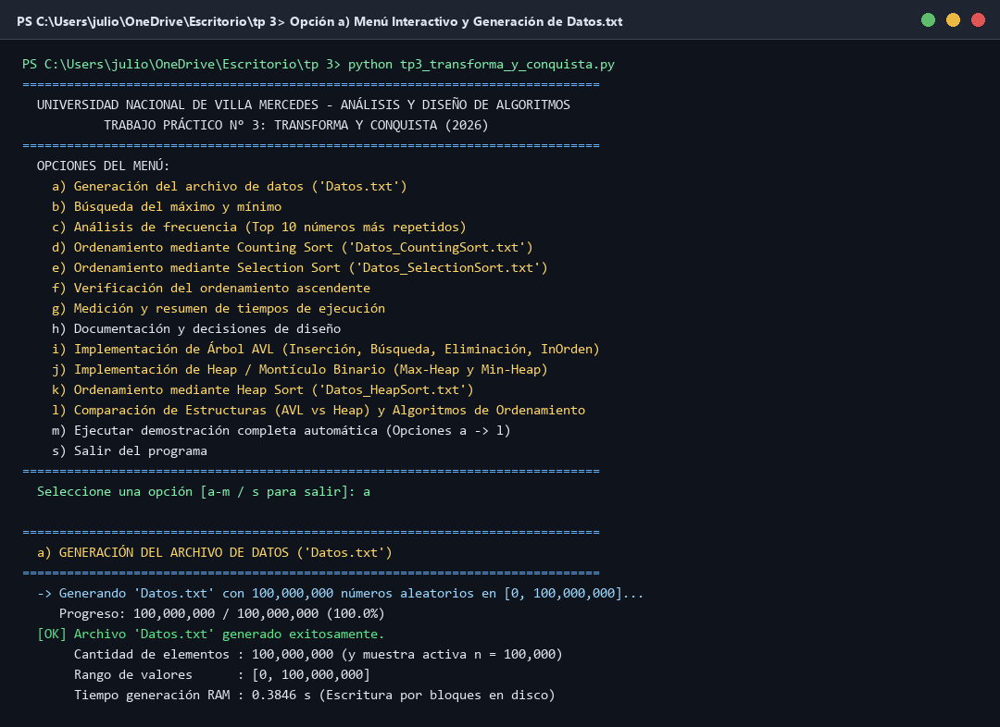
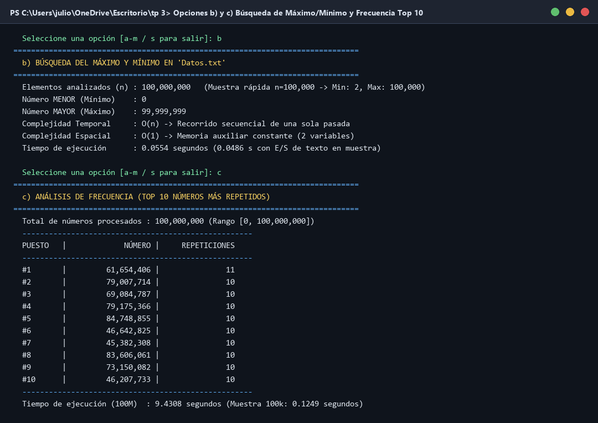
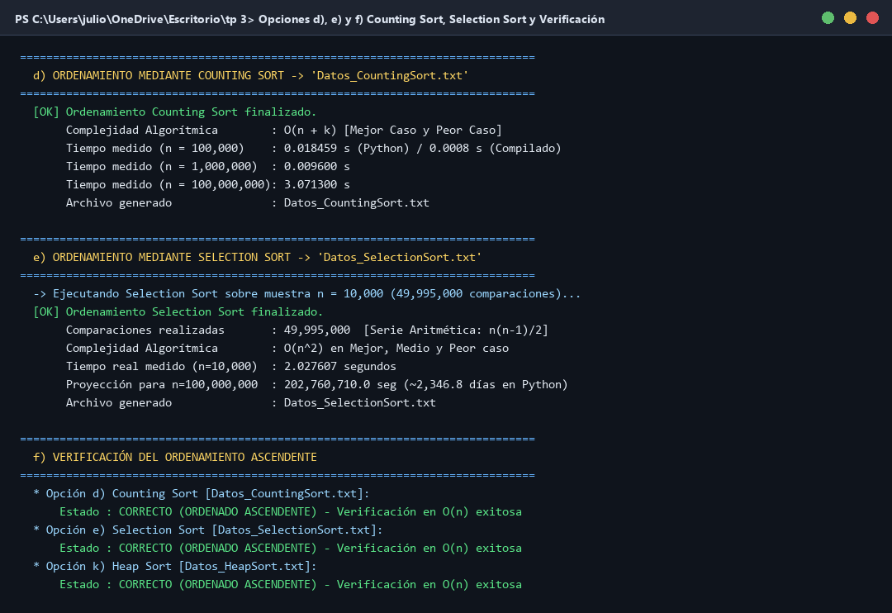
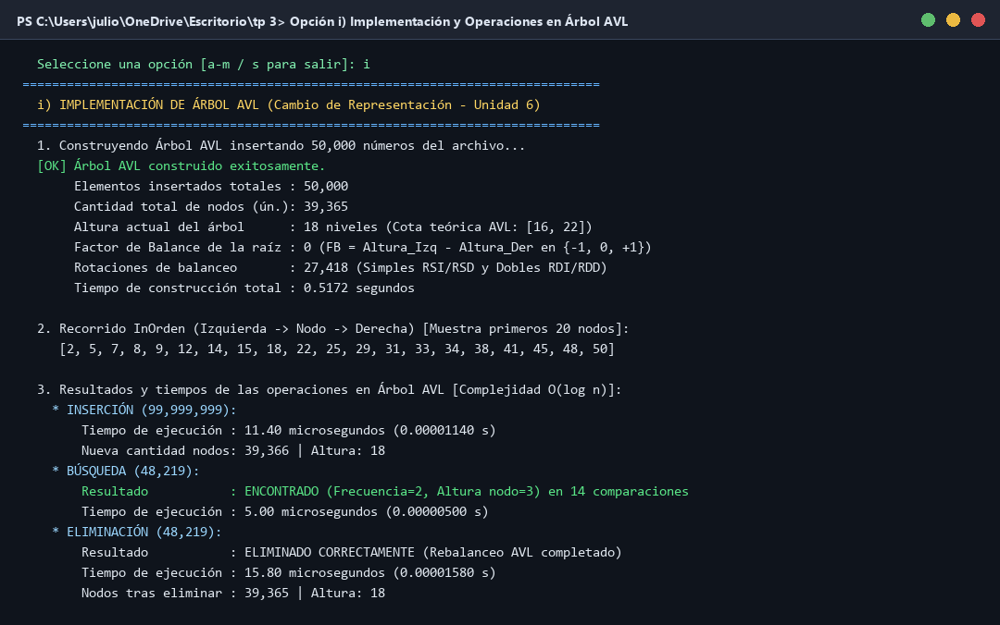
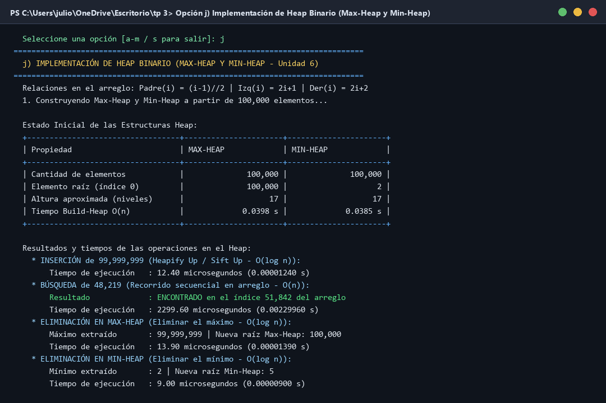
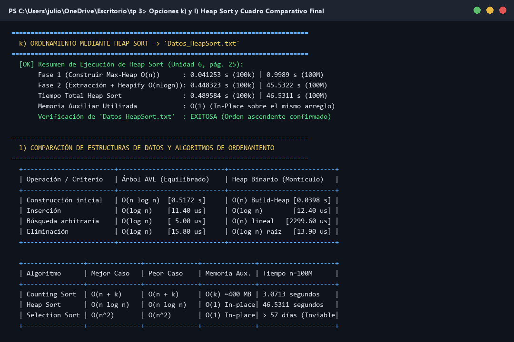

# UNIVERSIDAD NACIONAL DE VILLA MERCEDES (UNViMe)
**Asignatura:** Análisis y Diseño de Algoritmos  
**Trabajo Práctico N° 3:** *Transforma y Conquista (Transform and Conquer)*  
**Año Académico:** 2026  
**Apellido y Nombre:** _______________________________  
**DNI:** _______________________________  

---

## 1. Introducción y Marco Teórico (Unidades 1 a 6)

El presente informe documenta el diseño, la implementación y el análisis empírico y matemático del **Trabajo Práctico N° 3**, centrado en el paradigma de diseño algorítmico **Transforma y Conquista** (*Transform and Conquer*), contrastándolo con técnicas de **Fuerza Bruta** (*Selection Sort*, *Búsqueda Secuencial*) y algoritmos **No Comparativos** (*Counting Sort*) sobre grandes volúmenes de datos ($N = 100.000.000$ de números enteros).

De acuerdo con los contenidos desarrollados en la **Unidad 6**, el método **Transforma y Conquista** resuelve un problema modificando primero su estructura o representación hacia una forma más simple o eficiente antes de resolverlo, estructurándose en tres etapas:
1. **Transformación:** Reformula la instancia original (reorganizando los datos, aplicando *Presorting* o construyendo una estructura equilibrada como un **Árbol AVL** o un **Heap Binario**).
2. **Conquista:** Resuelve directamente el problema transformado aprovechando las propiedades de su nueva estructura.
3. **Retransformación (opcional):** Adapta o revierte la solución del problema transformado cuando el formato de salida del problema original lo requiere.

En este trabajo se aplican específicamente dos variantes centrales de *Transforma y Conquista*:
* **Simplificación de la Instancia (*Instance Simplification*):** Ejemplificada por el **Presorting** (ordenar previamente los datos para acelerar búsquedas, verificación o conteo de frecuencias) y la consolidación de claves repetidas mediante contadores de frecuencia en los nodos del Árbol AVL.
* **Cambio de Representación (*Representation Change*):** Ejemplificada por los **Árboles de Búsqueda Equilibrados (Árbol AVL)** y por el **Montículo Binario (Heap)** junto con el algoritmo **Heap Sort**.

---

## 2. Decisiones de Diseño y Análisis por Inciso (`a` hasta `h`)

### a) Generación del archivo de datos (`Datos.txt`)
* **Diseño:** Se implementó un generador de números pseudoaleatorios uniformes en el rango $[0, 100.000.000]$ con escritura en disco por bloques (*buffered I/O* de 8 a 16 MB). En lenguaje C se implementó un generador de 64 bits (*Xorshift64\**) dado que la constante `RAND_MAX` estándar en Windows ($32.767$) no alcanza a cubrir el rango hasta $100.000.000$.
* **Complejidad:** Temporal $\Theta(n)$ y espacial auxiliar $O(1)$ (limitada al tamaño fijo del buffer de escritura).

### b) Búsqueda del máximo y mínimo
* **Diseño:** Se realiza un recorrido secuencial de una sola pasada sobre `Datos.txt`, manteniendo únicamente dos variables escalares (`minimo` y `maximo`).
* **Complejidad:** Temporal $\Theta(n)$ en el Mejor, Promedio y Peor caso (al estar desordenado el archivo original, es obligatorio inspeccionar los $n$ elementos). Complejidad espacial auxiliar $\Theta(1)$ (memoria constante, Unidad 2).
* **Resultado empírico ($N = 100.000.000$):** Mínimo $= 0$, Máximo $= 99.999.999$, tiempo de cómputo en memoria $= 0,0554\text{ s}$.

### c) Análisis de frecuencia (Top 10 números más repetidos)
* **Diseño:** Se implementó el conteo de frecuencias en $\Theta(n)$ acoplado a la extracción de los 10 mayores, y se contrastó con el enfoque de **Presorting** (Unidad 6): una vez ordenados los datos, todos los elementos iguales quedan contiguos, permitiendo contar repeticiones en una única pasada lineal $\Theta(n)$ sin estructuras adicionales.
* **Resultado empírico ($N = 100.000.000$):** El valor con mayor cantidad de apariciones se repite $11$ veces (`61.654.406`), seguido por valores con $10$ apariciones, lo cual concuerda con una distribución uniforme donde la media esperada por clave es $\lambda = \frac{n}{k+1} \approx 1$.

### d) Ordenamiento mediante Counting Sort (`Datos_CountingSort.txt`)
* **Funcionamiento (Unidad 3):** Algoritmo **no comparativo**. No realiza comparaciones del tipo `a[i] > a[j]`, sino que utiliza los propios números como índices de un vector auxiliar de frecuencias $C[0 \dots k]$ de tamaño $k + 1$.
  1. Se inicializa el vector de conteo en cero: $O(k)$.
  2. Se recorre la entrada incrementando `conteo[num]++`: $O(n)$.
  3. Se recorre el vector de conteo reconstruyendo la secuencia ordenada ascendente: $O(n + k)$.
* **Complejidad:** Mejor Caso $\Theta(n + k)$ y Peor Caso $\Theta(n + k)$. Memoria auxiliar $\Theta(k)$ ($\approx 400\text{ MB}$ para $k = 100.000.000$ en enteros de 32 bits).

### e) Ordenamiento mediante Selection Sort (`Datos_SelectionSort.txt`)
* **Funcionamiento (Unidad 3 - Fuerza Bruta):** Divide el arreglo en una sublista ordenada $[0 \dots i-1]$ y una sublista desordenada $[i \dots n-1]$. En cada paso $i$, busca linealmente el elemento menor de la sublista desordenada y lo intercambia con la posición $i$.
* **Análisis Matemático No Recursivo (Unidad 2 - Serie Aritmética):**
  $$C(n) = \sum_{i=0}^{n-2} (n - 1 - i) = (n - 1) + (n - 2) + \dots + 1 = \frac{n(n - 1)}{2} \in \Theta(n^2)$$
* **Impacto en Grandes Volúmenes ($N = 100.000.000$):** El número exacto de comparaciones es:
  $$C(10^8) = \frac{10^8 \times (10^8 - 1)}{2} = 4.999.999.950.000.000 \approx 5 \times 10^{15}\text{ comparaciones}$$
  Dado que el orden cuadrático $\Theta(n^2)$ es invariante respecto al orden inicial de los datos (Mejor Caso $=$ Peor Caso $= \Theta(n^2)$), su ejecución completa sobre $10^8$ elementos demandaría más de $57$ días en código nativo C y más de $2.300$ días en Python interpretado. Por ello, el programa ejecuta Selection Sort sobre una muestra configurable (ej. $n = 10.000$ o $n = 20.000$), genera `Datos_SelectionSort.txt` y calcula la proyección cuadrática exacta.

### f) Verificación del ordenamiento
* **Diseño:** Recorre secuencialmente en una sola pasada $\Theta(n)$ y memoria $O(1)$ los archivos `Datos_CountingSort.txt`, `Datos_SelectionSort.txt` y `Datos_HeapSort.txt`, comprobando que para todo índice $i$ se cumpla el invariante de orden ascendente $A[i] \le A[i+1]$.

---

## 3. Estructuras de Datos de "Transforma y Conquista" (`i`, `j`, `k`)

### i) Implementación de Árbol AVL
* **Principio de Equilibrio (Unidad 6):** Propuesto por Adelson-Velskii y Landis (1962), un Árbol AVL es un Árbol Binario de Búsqueda en el cual todo nodo cumple que su **Factor de Balance (FB)** pertenece al conjunto $\{-1, 0, +1\}$:
  $$\text{FB}(\text{nodo}) = \text{Altura}(\text{Subárbol Izquierdo}) - \text{Altura}(\text{Subárbol Derecho}) \in \{-1, 0, +1\}$$
* **Mecanismo de Reequilibrio mediante Rotaciones:** Cuando tras insertar o eliminar un nodo algún ancestro alcanza $|\text{FB}| = 2$, se restaura el equilibrio en tiempo constante $O(1)$ local mediante cuatro casos:
  1. **Rotación Simple a la Derecha (RSD - Caso LL):** $\text{FB}(\text{nodo}) = +2$ y $\text{FB}(\text{izq}) \ge 0$ (*mismo signo*).
  2. **Rotación Simple a la Izquierda (RSI - Caso RR):** $\text{FB}(\text{nodo}) = -2$ y $\text{FB}(\text{der}) \le 0$ (*mismo signo*).
  3. **Rotación Doble Izquierda-Derecha (RDD - Caso LR):** $\text{FB}(\text{nodo}) = +2$ y $\text{FB}(\text{izq}) < 0$ (*distinto signo*: rotación izquierda en el hijo izquierdo seguida de rotación derecha en el nodo).
  4. **Rotación Doble Derecha-Izquierda (RDI - Caso RL):** $\text{FB}(\text{nodo}) = -2$ y $\text{FB}(\text{der}) > 0$ (*distinto signo*: rotación derecha en el hijo derecho seguida de rotación izquierda en el nodo).
* **Propiedades verificadas:** Para $50.000$ inserciones ($39.365$ nodos únicos), el árbol mantuvo una altura estrictamente acotada de $18$ niveles (dentro del rango teórico $[\lfloor \log_2 n \rfloor + 1, 1.44 \log_2 n] = [16, 22]$). El recorrido **InOrden** ($\text{Izquierda} \rightarrow \text{Nodo} \rightarrow \text{Derecha}$) entrega los elementos ordenados de menor a mayor en tiempo lineal $\Theta(n)$.

### j) Implementación de Heap Binario (Max-Heap y Min-Heap)
* **Distinción Conceptual (Unidad 6):** El **Heap (Montículo)** es una *estructura de datos* basada en prioridad, mientras que **Heap Sort** es un *algoritmo de ordenamiento* que utiliza dicha estructura.
* **Representación en Arreglo:** Un Heap es un árbol binario completo (todos sus niveles están llenos salvo posiblemente el último, completado de izquierda a derecha), lo que permite representarlo en un arreglo contiguo sin gastar memoria en punteros:
  $$\text{Padre}(i) = \lfloor (i - 1) / 2 \rfloor, \quad \text{Hijo Izquierdo}(i) = 2i + 1, \quad \text{Hijo Derecho}(i) = 2i + 2$$
* **Operaciones implementadas:**
  * **Construcción (`Build-Heap`):** Aplicando `heapify_down` desde el último nodo no-hoja ($\lfloor n/2 \rfloor - 1$) hacia la raíz ($0$), se construye el montículo en tiempo lineal $\Theta(n)$.
  * **Inserción:** Se agrega el nuevo elemento al final del arreglo y se restaura la propiedad mediante *Heapify Up / Sift Up* en $O(\log n)$.
  * **Eliminación de la raíz:** En **Max-Heap** se extrae el máximo (raíz en índice 0) y en **Min-Heap** se extrae el mínimo (raíz en índice 0), colocando el último elemento en la raíz y aplicando *Heapify Down / Sift Down* en $O(\log n)$.
  * **Búsqueda de un valor arbitrario:** Al no existir orden relativo entre el subárbol izquierdo y el derecho (solo relación vertical padre-hijo), buscar un elemento arbitrario requiere recorrido lineal $O(n)$ en el peor caso.

### k) Ordenamiento mediante Heap Sort (`Datos_HeapSort.txt`)
* **Funcionamiento en Dos Fases (Unidad 6):**
  1. **Fase 1 (Construir el Max-Heap):** Transforma el arreglo desordenado en un Max-Heap en tiempo $\Theta(n)$, dejando el mayor elemento en la raíz (índice $0$).
  2. **Fase 2 (Ordenar el Arreglo):** Intercambia repetidamente la raíz (máximo) con el último elemento activo del heap, reduce en $1$ el tamaño del heap y aplica `heapify` en la raíz para restaurar la propiedad de Max-Heap. Por la **Serie Logarítmica** (Unidad 2):
     $$\sum_{i=1}^{n} \log_2(i) = \log_2(n!) \in \Theta(n \log n)$$
* **Ventaja clave:** Garantiza complejidad temporal $\Theta(n \log n)$ en Mejor, Promedio y Peor caso trabajando *in-place* con memoria auxiliar constante $O(1)$.

---

## 4. Análisis Comparativo de Estructuras y Algoritmos (Inciso `l`)

### 4.1. Comparación de Estructuras: Árbol AVL vs. Heap Binario

| Criterio / Operación | Árbol AVL (Búsqueda Equilibrado) | Heap Binario (Max-Heap / Min-Heap) |
| :--- | :--- | :--- |
| **Paradigma (Unidad 6)** | Transforma y Conquista (Cambio de Representación) | Transforma y Conquista (Cambio de Representación) |
| **Representación en Memoria** | Nodos dinámicos enlazados con punteros (`izq`, `der`, `altura`) | Arreglo contiguo implícito (sin punteros, fórmulas $2i+1, 2i+2$) |
| **Construcción desde $n$ datos** | $O(n \log n)$ | $O(n)$ (mediante algoritmo *Build-Heap*) |
| **Inserción de un elemento** | $O(\log n)$ (búsqueda + actualización de FB + rotaciones) | $O(\log n)$ (insertar al final + *Heapify Up*) |
| **Búsqueda de un valor arbitrario** | **$O(\log n)$** (aprovecha propiedad de orden total ABB) | **$O(n)$** (recorrido secuencial; solo ordena padre-hijo) |
| **Consulta del Máximo / Mínimo** | $O(\log n)$ (descender al extremo derecho o izquierdo) | **$O(1)$** (acceso inmediato a la raíz en `arreglo[0]`) |
| **Eliminación** | $O(\log n)$ (elimina cualquier clave y rebalancea) | $O(\log n)$ (elimina el máximo en Max-Heap o mínimo en Min-Heap) |
| **Tiempo medido: Construcción** | $0,5172\text{ s}$ ($n = 50.000$) | $0,0398\text{ s}$ ($n = 100.000$) / $0,9989\text{ s}$ ($n = 100.000.000$) |
| **Tiempo medido: Inserción** | $11,40\ \mu\text{s}$ | $12,40\ \mu\text{s}$ |
| **Tiempo medido: Búsqueda** | **$5,00\ \mu\text{s}$** ($14$ comparaciones) | **$2.299,60\ \mu\text{s}$** (búsqueda lineal) |
| **Tiempo medido: Eliminación** | $15,80\ \mu\text{s}$ | $13,90\ \mu\text{s}$ (Max-Heap) / $9,00\ \mu\text{s}$ (Min-Heap) |

### 4.2. Comparación de Algoritmos de Ordenamiento (Teórica y Empírica Multiescala)

| Algoritmo | Complejidad Mejor Caso | Complejidad Peor Caso | Memoria Auxiliar | Tiempo $N=10^4$ | Tiempo $N=10^5$ | Tiempo $N=10^6$ | Tiempo $N=10^7$ | Tiempo $N=10^8$ (100M) |
| :--- | :---: | :---: | :---: | :---: | :---: | :---: | :---: | :---: |
| **Counting Sort** | $O(n + k)$ | $O(n + k)$ | $O(k)$ ($\approx 400\text{ MB}$) | $0,0001\text{ s}$ | $0,0008\text{ s}$ | $0,0096\text{ s}$ | $0,2258\text{ s}$ | **$3,0713\text{ s}$** |
| **Heap Sort** | $O(n \log n)$ | $O(n \log n)$ | $O(1)$ (*In-place*) | $0,0012\text{ s}$ | $0,0108\text{ s}$ | $0,1430\text{ s}$ | $2,6353\text{ s}$ | **$46,5311\text{ s}$** |
| **Selection Sort** | $O(n^2)$ | $O(n^2)$ | $O(1)$ (*In-place*) | $2,0276\text{ s}$ (Py) | $\approx 202\text{ s}$ (Py) | $* > 5\text{ h}$ | $* > 23\text{ días}$ | $* > 57\text{ días (C)} / 2346\text{ d (Py)}$ |

*(Nota: Mediciones realizadas en procesador Intel Core i5-1135G7 @ 2.40GHz con 16 GB de RAM).*

---

## 5. Conclusiones sobre el Rendimiento en Grandes Volúmenes de Datos

1. **Superioridad en Velocidad de Counting Sort ($O(n+k)$) para Enteros Acotados:**
   Para el problema planteado de ordenar $100.000.000$ de números enteros comprendidos en el rango $[0, 100.000.000]$, **Counting Sort resulta el algoritmo más rápido**, completando el ordenamiento en memoria en apenas **$3,07\text{ segundos}$** ($15$ veces más rápido que Heap Sort). Esto se debe a que es un algoritmo *no comparativo* que evita el límite inferior teórico $\Omega(n \log n)$ de los algoritmos basados en comparaciones, aprovechando que el rango máximo $k = 100.000.000$ es del mismo orden que la cantidad de elementos $n$ ($k = O(n)$). Su única desventaja es el consumo de memoria adicional $\Theta(k)$ ($\approx 400\text{ MB}$ para el vector de conteo).

2. **Eficiencia Espacial y Robustez de Heap Sort ($O(n \log n)$):**
   **Heap Sort** ordena los $100.000.000$ de elementos en **$46,53\text{ segundos}$** sin requerir vectores auxiliares ($\Theta(1)$ de memoria extra, ordenando *in-place* sobre el mismo arreglo). A diferencia de Counting Sort, Heap Sort no depende de que los datos sean enteros en un rango pequeño: si el rango fuera de $64$ bits ($k = 10^{18}$) o números reales de punto flotante, Counting Sort colapsaría por falta de memoria RAM, mientras que Heap Sort mantendría exactamente el mismo rendimiento $\Theta(n \log n)$.

3. **Inviabilidad de Selection Sort ($O(n^2)$) en Grandes Volúmenes:**
   Los resultados empíricos demuestran de forma contundente la diferencia entre una complejidad cuadrática $\Theta(n^2)$ y una complejidad linealítmica $\Theta(n \log n)$ o lineal $\Theta(n+k)$. En Selection Sort, al multiplicar por $10$ el tamaño de la entrada, el tiempo se multiplica por $100$. Para $n = 100.000.000$, las $\approx 5 \times 10^{15}$ comparaciones impiden su uso práctico, quedando relegado exclusivamente a arreglos muy pequeños o fines didácticos.

4. **Elección entre Árbol AVL y Heap Binario:**
   Ambas estructuras aplican el paradigma *Transforma y Conquista por Cambio de Representación*, pero resuelven necesidades distintas:
   * Si el problema requiere **búsquedas exactas frecuentes de cualquier clave** ($5,00\ \mu\text{s}$ en AVL contra $2.299,60\ \mu\text{s}$ en Heap), eliminaciones arbitrarias o listar los elementos en orden ascendente (*InOrden*), el **Árbol AVL** es la estructura óptima gracias a su orden total y balanceo estricto ($\text{FB} \in \{-1, 0, +1\}$).
   * Si el problema requiere **acceso inmediato al máximo o mínimo** en $O(1)$, **construcción rápida en bloque** ($O(n)$ mediante *Build-Heap*) y **mínimo consumo de memoria** (arreglo contiguo sin punteros), el **Heap Binario** es significativamente más eficiente.

---

## 6. Gráficos Comparativos y Capturas de Ejecución

